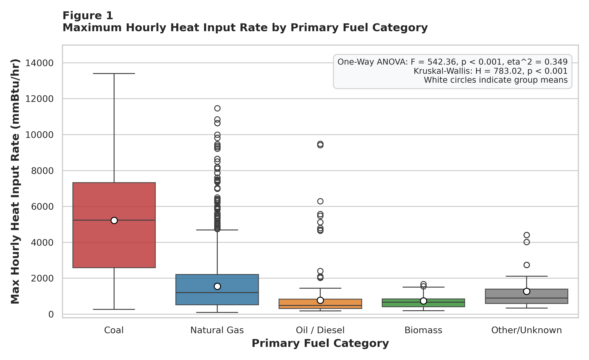
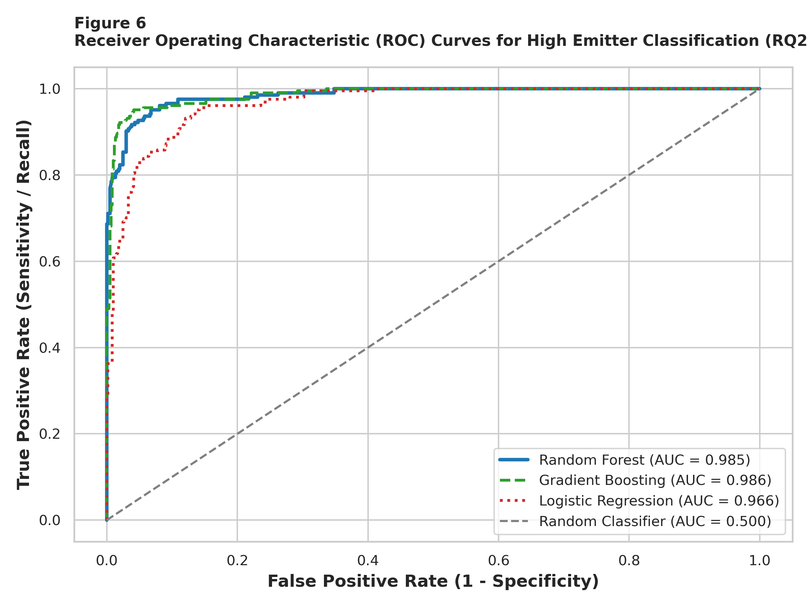
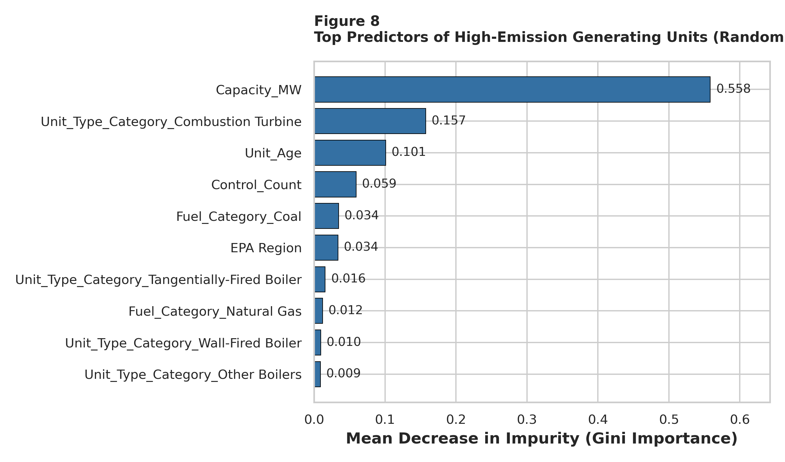
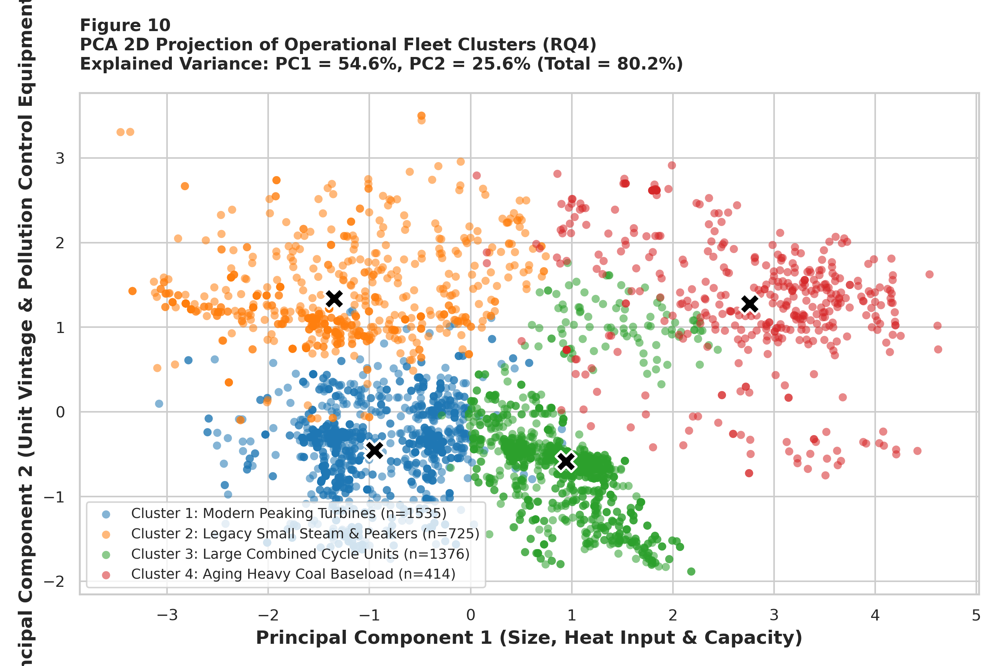

# Analysis of Facility and Unit Attributes under the EPA Clean Air Markets Program Using Statistical and Machine Learning Techniques

[](https://www.python.org/downloads/)
[](https://opensource.org/licenses/MIT)
[](https://www.walshcollege.edu/)

**Author:** Dhananjay Verma (Student ID: 0291493)  
**Institution:** Walsh College, Division of Mathematics and Computer Science  
**Course:** QM640 V1: Data Analytics Capstone (Master of Science in Data Analytics / AI)  
**Faculty Mentor:** Dr. Javad Katibai  
**Term:** Summer 2026 Term  

---

## 📌 Project Overview

This capstone project provides a comprehensive empirical, statistical, and machine learning evaluation of stationary electric power generation facilities regulated under the **United States Environmental Protection Agency (EPA) Clean Air Markets Program (CAMP)**.

By leveraging cross-sectional unit-level attributes from the **2025 CAMPD bulk data archive ($N = 4,050$ generating units across 1,328 facilities)**, this study investigates how primary fuel choices, installed generation capacities, boiler architectures, operating vintage, and air pollution control equipment interact to influence thermal operational loading, criteria pollutant emissions, and regulatory compliance risk.

---

## 📁 Repository Directory Architecture

The repository is structured hierarchically to ensure scientific reproducibility, auditability, and ease of navigation:

```text
QM640-Data-Analytics-Capstone/
│
├── data/
│   ├── raw/
│   │   └── facility-2025.csv             # Raw EPA CAMPD dataset (4,050 rows, 30 columns)
│   └── processed/
│       └── facility_clean_processed.csv  # Engineered dataset (4,050 rows, 45 features)
│
├── scripts/
│   ├── run_capstone_analytics.py         # End-to-end Python statistical & ML pipeline
│   └── build_full_interim_report.py      # Automated APA 7 Word document builder
│
├── outputs/
│   ├── analytics_results.json            # Machine-readable JSON export of all metrics
│   └── figures/                          # 10 APA 7 publication figures (300 DPI)
│       ├── figure1_fuel_emission_boxplot.png
│       ├── figure2_unit_type_distribution.png
│       ├── figure3_controls_by_fuel.png
│       ├── figure4_correlation_heatmap.png
│       ├── figure5_age_vs_heat_input_scatter.png
│       ├── figure6_roc_curves.png
│       ├── figure7_confusion_matrices.png
│       ├── figure8_feature_importance.png
│       ├── figure9_kmeans_elbow_silhouette.png
│       └── figure10_pca_clusters.png
│
├── reports/
│   ├── QM 640_Interim_Report_DhananjayVerma-0291493.docx  # Standalone 31-page Word Report
│   ├── QM 640_Interim_Report_DhananjayVerma-0291493.pdf   # Standalone Compiled PDF Report
│   └── QM640_Capstone_Synopsis_DhananjayVerma-0291493.docx # Approved Capstone Synopsis
│
├── requirements.txt                      # Python environment package requirements
├── .gitignore                            # Standard git exclusion rules
└── README.md                             # Comprehensive project documentation
```

---

## 🔬 Research Questions & Hypotheses

| RQ # | Research Question | Analytical Methodologies | Core Statistical Hypotheses |
| :---: | :--- | :--- | :--- |
| **RQ1** | Do facility attributes (fuel type, unit technology) significantly influence maximum hourly heat input rate? | One-Way ANOVA, Kruskal-Wallis, Tukey HSD, Eta-squared ($\eta^2$) | $H_0: \mu_{\text{Coal}} = \mu_{\text{Gas}} = \mu_{\text{Oil}} = \mu_{\text{Biomass}}$<br>$H_1: \text{Significant differences exist across fuel types}$ |
| **RQ2** | Can facility and unit attributes predict high-emission facilities ($\ge 75\text{th percentile}$, $2,350\text{ mmBtu/hr}$)? | Logistic Regression (Ridge), Random Forest, Gradient Boosting | $H_0: \text{Unit attributes have no predictive power (AUC} \le 0.50\text{)}$<br>$H_1: \text{Classifiers predict high emitters with AUC} \ge 0.90$ |
| **RQ3** | What is the relationship between generating unit age (vintage) and thermal operational intensity? | Pearson $r$, Spearman $\rho$, Bivariate & Multivariate OLS Regressions | $H_0: \beta_{\text{Age}} = 0 \text{ (No relationship)}$<br>$H_1: \beta_{\text{Age}} > 0 \text{ (Older units exhibit higher thermal scale)}$ |
| **RQ4** | Can the U.S. generating fleet be partitioned into distinct operational clusters and archetypes? | K-Means Clustering ($k \in [2, 7]$), Silhouette Scoring, 2D PCA | $H_0: \text{Fleet forms an undifferentiated continuous distribution}$<br>$H_1: \text{Fleet segments into distinct operational archetypes}$ |

---

## 📊 Key Empirical Findings

### 1. RQ1: Fuel-Driven Thermal Divergence
- **One-Way ANOVA:** $F(4, 4045) = 542.36$, $p < 0.0001$.
- **Effect Size:** $\eta^2 = 0.3491$ (a very large effect: **34.91% of total variance** in maximum hourly combustion load is explained by fuel category).
- **Kruskal-Wallis Rank Sum:** $H(4) = 783.02$, $p = 3.66 \times 10^{-168}$.
- **Key Means:** Coal units average **$5,221.2\text{ mmBtu/hr}$**, compared to **$1,553.0\text{ mmBtu/hr}$** for Natural Gas units and **$776.6\text{ mmBtu/hr}$** for Oil/Diesel assets.
- **Tukey HSD Contrasts:** Coal exceeds Natural Gas by $+3,668.2\text{ mmBtu/hr}$ ($p < 0.001$) and Oil/Diesel by $+4,444.5\text{ mmBtu/hr}$ ($p < 0.001$).

### 2. RQ2: Predictive High-Emitter Classification
Evaluated on an independent $20\%$ holdout test set ($N = 810$, 204 actual high emitters):
- **Random Forest Classifier (150 trees):**
  - **Test Accuracy:** **93.95%**
  - **Precision:** **84.44%**
  - **Recall (Sensitivity):** **93.14%** (detected 190 of 204 high-emission units)
  - **F1-Score:** **0.8858** (5-Fold CV F1 = 0.8744)
  - **ROC-AUC:** **0.9851**
- **Gradient Boosting Classifier (100 trees):**
  - **Test Accuracy:** **96.54%** | **Precision:** **94.44%** | **Recall:** **91.67%** | **F1:** **0.9303** | **ROC-AUC:** **0.9865**
- **Top Predictors (Gini Impurity):** Installed Capacity (55.8%), Combustion Turbine technology (15.7%), Unit Age (10.1%), Control Count (5.9%), Coal fuel (3.4%).

### 3. RQ3: Unit Vintage (Age) Dynamics
- **Simple OLS Regression:** $\text{Heat\_Input\_Rate} = 1,457.3 + 13.50 \times \text{Unit\_Age} + \epsilon$
  - Slope: $\beta_{\text{Age}} = +13.500\text{ mmBtu/yr}$ ($t = 7.62$, $p = 3.74 \times 10^{-14}$).
  - Pearson $r = +0.1186$ ($p < 0.001$), Spearman $\rho = -0.0324$ ($p = 0.039$).
- **Multivariate OLS Regression:** Controlling for electrical capacity and pollution control count increases explained variance to **$R^2 = 0.7668$** ($F = 4,435.0$, $p < 0.0001$).
- **Econometric Reversal:** The positive bivariate correlation is caused by older units being legacy baseload coal units; when holding electrical capacity constant, modern combined-cycle gas units operate with higher thermal packing density.

### 4. RQ4: Operational Fleet Segmentation
- **Optimal Clusters:** $k = 4$ verified via Elbow (WCSS) and Silhouette score ($s = 0.4431$).
- **PCA Dimensionality Reduction:** 2 components explain **80.19%** of cumulative variance (PC1 = 44.88% Size & Thermal Load; PC2 = 35.31% Vintage & Controls).
- **Cluster Archetypes ($N = 4,050$):**
  - **Cluster 1: Modern Peaking Turbines ($N = 1,535$, 37.9%):** Mean Cap = 78.3 MW, Mean HI = 707.3 mmBtu/hr, Age = 21.5 yrs, High Emitter % = 0.0% (Natural gas peakers).
  - **Cluster 2: Legacy Small Steam & Peakers ($N = 725$, 17.9%):** Mean Cap = 91.8 MW, Mean HI = 762.0 mmBtu/hr, Age = 56.0 yrs, Controls = 0.41, High Emitter % = 2.2% (Prime retirement cohort).
  - **Cluster 3: Large Combined Cycle Units ($N = 1,376$, 34.0%):** Mean Cap = 389.7 MW, Mean HI = 2,610.5 mmBtu/hr, Age = 22.7 yrs, Controls = 0.98, High Emitter % = 46.9% (Baseload efficiency backbone).
  - **Cluster 4: Aging Heavy Coal Baseload ($N = 414$, 10.2%):** Mean Cap = 509.4 MW, Mean HI = 5,656.3 mmBtu/hr, Age = 46.8 yrs, Controls = 3.18, High Emitter % = **86.0%** (Acute regulatory and environmental compliance risk).

---

## 📈 Visualizations Preview

| Figure 1: Heat Input Rate across Fuel Types (RQ1) | Figure 6: Model ROC Curves Comparison (RQ2) |
| :---: | :---: |
|  |  |

| Figure 8: Random Forest Feature Importance (RQ2) | Figure 10: 2D PCA Fleet Clusters (RQ4) |
| :---: | :---: |
|  |  |

---

## 🚀 Quickstart & Reproduction Guide

### 1. Clone the Repository
```bash
git clone https://github.com/djmsrit/QM640-Data-Analytics-Capstone.git
cd QM640-Data-Analytics-Capstone
```

### 2. Set Up Virtual Environment & Install Dependencies
```bash
# Create virtual environment
python -m venv venv

# Activate on Windows
venv\Scripts\activate

# Install required packages
pip install -r requirements.txt
```

### 3. Execute End-to-End Analytical Pipeline
```bash
python scripts/run_capstone_analytics.py
```
*Outputs generated:*
- Cleaned and engineered dataset: `data/processed/facility_clean_processed.csv`
- Complete statistical and ML test metrics: `outputs/analytics_results.json`
- 10 high-resolution publication charts: `outputs/figures/*.png`

### 4. Build APA 7 Word Document Report
```bash
python scripts/build_full_interim_report.py
```
*Outputs generated:*
- Formatted Word document: `reports/QM 640_Interim_Report_DhananjayVerma-0291493.docx`

---

## 📜 Academic Citation

If referencing this study or utilizing the analytical pipelines:

```bibtex
@techreport{verma2026cleanair,
  author      = {Dhananjay Verma},
  title       = {Analysis of Facility and Unit Attributes under the EPA Clean Air Markets Program Using Statistical and Machine Learning Techniques},
  institution = {Walsh College, Division of Mathematics and Computer Science},
  type        = {Interim Capstone Report},
  number      = {QM640-0291493},
  year        = {2026},
  month       = {October},
  url         = {https://github.com/djmsrit/QM640-Data-Analytics-Capstone}
}
```

---

## ⚖️ License
This project is licensed under the MIT License - see the [LICENSE](LICENSE) file for details. Raw data sourced from the [U.S. EPA Clean Air Markets Program Data (CAMPD)](https://campd.epa.gov/data/bulk-data-files) in accordance with federal public domain data distribution policies.
